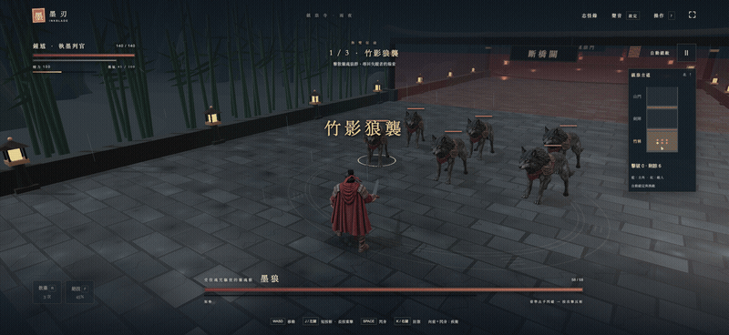
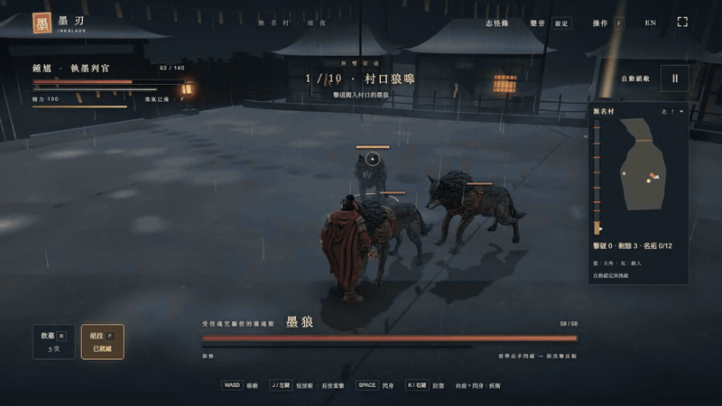
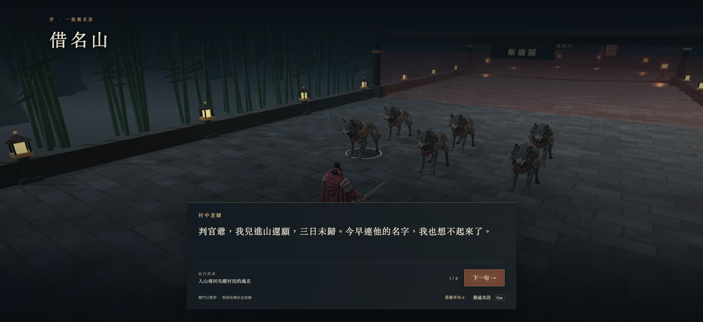
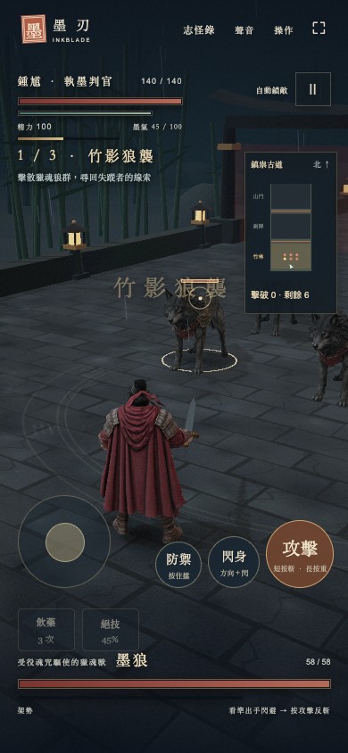

# Inkblade — a 3D ink fantasy combat game

[繁體中文](README.md)

Inkblade is a playable third-person 3D action prototype inspired by Zhong Kui and Chinese ghost stories. Sword in hand, the hero enters a rain-soaked temple to learn why villagers' names have been taken. Follow the campaign through a wolf pack, a swordsman encounter and a final mountain monster.

**[Play in your browser](https://inkblade-e2h.pages.dev/)**

## Gameplay



### The ultimate: Ink Sunders the Mountains (墨破山河)



With a full ink gauge, press F (or Ultimate on a phone). The camera closes in on Zhong Kui's face, then cuts low to look up the length of the raised sword while ink drifts in toward the blade and the move's name strikes in from the side. The world then drains to cold ink, leaving colour only on what glows, the hero whirls through a flurry of cuts, and the last blow lands in a burst of golden seal circle and light.

| Story scene | Mobile controls |
| --- | --- |
|  |  |

The online game is hosted on Cloudflare Pages and redeploys whenever GitHub `main` changes.

## What's new

**2026-11-14**

- English version, switchable with the Chinese / English button in the top-right corner.
- Phones: fast attack taps no longer zoom the page; controls sit at the bottom edge; the map folds away; the title screen no longer covers the characters.
- Moving while guarding is now a walk instead of a slide.
- The title screen has a single way in, Begin the Journey; the three opponents are bosses along the road.
- The campaign grew to ten chapters across eight regions, with new foes and moves and a plain-spoken script.
- A major art update; see Art upgrades below.

## Art upgrades

This round (2026-11-13 to 14) set out to push the look toward a AAA action game. Most of the change is in the art:

- **Real skeletons and motion-captured animation.** The hero, the swordsman Shen Hanzhou and the mountain demon used to be posed by code. They are now auto-rigged with Meshy (through Higgsfield) and play motion-capture clips: 15 for the hero (idle, run, three light cuts, heavy strike, dodge, guard, fighting-stance walk, hurt, death, and the shout, flurry and leaping downward cut of the ultimate), 8 for the swordsman and 7 for the demon. The first rigging attempt failed because each model faced 90 degrees away from its skeleton, so walking dragged the legs and robes sideways; every model is now turned to face forward before it is rigged. The process is in [`art/direction/rigged/README.md`](art/direction/rigged/README.md).
- **Footwork behind the guard.** The motion library had no walk with the sword raised in guard, so the legs come from a bought fighting-stance walk while the upper body holds the guard, with the turn of the hips taken back out so the sword stays still. Sideways steps are solved on the skeleton so each foot stays where it lands.
- **Two new foes with their own models.** The Name-Copying Scribe and the Gate Beast used to borrow the swordsman's and the wolf's bodies in new colours. Each now has a GPT Image reference turned into 3D with Tripo H3.1; the scribe is rigged and shares the swordsman's clips, and the beast is skinned in the game on a four-legged skeleton. See [`art/direction/foes/README.md`](art/direction/foes/README.md).
- **The ultimate and move effects.** Ink Sunders the Mountains has two close-up shots, focus lines, gathering ink and a seal circle (GIF above). The new moves have their own visuals too: Flying Ink is a flying crescent of ink, Edict: Seal spreads a talisman ring on the ground, and Mountain Breaker and the leaping cut crack the ground and throw up dust. Each effect is drawn where the combat rules say the blow actually lands.
- **Post-processing.** The scene renders in linear light, so lanterns, sparks and blade light can go past white and bloom naturally (HDR with a multi-level bloom). The frame edge has a slight colour fringe that kicks on heavy hits; shadows lean to cold ink and highlights to lamp-warm.
- **A rainy night.** A moonlit cloud dome, rain that follows the camera with splashes on the ground, mist, lantern embers, and distant lightning that flashes, goes dark and glows again. All of it is animated in shaders for only a few extra draw calls.
- **Eight regions, each its own place.** Every stretch of the mountain road has its own ground, edges and landmarks: blank door plaques in the nameless village, bamboo closing overhead in the rain forest, steles scraped blank in the forest of a thousand names, a bridge over a drop with no bottom, a lantern road where every lamp is a name burning, the empty plinths of the guardians in the temple forecourt, and a hall hung with name tablets. The ground carries painted cart ruts and standing water. Props are drawn in batches and regions swallowed by fog are hidden, so it stays smooth.
- **Title key art.** Nano Banana 2.1, given the in-game character models as reference, painted Zhong Kui facing the mountain demon on the temple steps. The art drifts slowly with a lightning flash now and then, and phones held upright get their own framing so the title and button keep clear of both faces. See [`art/direction/cover/README.md`](art/direction/cover/README.md).

## Story and modes

The stolen names have trapped the villagers' spirits in the mountains. Zhong Kui follows the trail through a bamboo forest, meets wolves bound by a curse, and faces the swordsman Shen Hanzhou, who has his own reason to guard the road. At the end waits a mountain monster claiming to protect the village. Dialogue, battle cries and an in-game journal carry the story.

- **Campaign:** A road of about 350 m up the mountain in ten chapters across eight regions: the nameless village, rain bamboo forest, forest of a thousand steles, the ravine bridge, the lantern road, the temple forecourt, the Hall of Borrowed Names, and a two-phase final fight in the temple courtyard. Foes hold their posts until you come near; there are ambushes, eleven enemy types, twelve collectible name rubbings and three roadside shrines. The route data lives in `dist/journey3d.js`.
- **Action combat:** Chain sword attacks, dash forward and strike, dodge sideways, guard, parry and counterattack. Each opponent has a distinct pace; wolves only fight up close.

## Play locally

```bash
git clone git@github.com:ywchiu/inkblade.git
cd inkblade
npm ci
npm start
```

Open <http://127.0.0.1:4173/> in a WebGL 2 browser. Playing does not require an AI account or API key.

## Basic controls

| Action | Control |
| --- | --- |
| Move | WASD or arrow keys |
| Attack | Tap J / left click; hold for a heavy attack |
| Dodge and forward dash | Space with a movement direction |
| Guard and parry | Hold K / right click |
| Heal / special | R / F |

Tap attack to chain up to five sword strikes, or hold it for a heavy strike. Attack while dashing forward for a dash cut, or while sprinting (Shift plus a direction) for a leaping cut. While holding guard, tap attack to throw a crescent of ink (20 ink) or hold attack to slam a sealing ring around you (40 ink). A well-timed dodge or parry opens a counterattack. On a touch screen, move with the stick and push it past its ring to sprint; the three main action buttons are on the right.

## Making the game with AI

1. **Set the scope and visual direction.** Start with the hero, opponents, rainy temple, single duels and a short campaign (the duel entry was later folded into the campaign, where its three opponents are bosses along the road). Aim for grounded Chinese fantasy, with ink in the atmosphere and combat effects.
2. **Create character references.** GPT Image shaped the hero and environment; Nano Banana 2.1 supplied other character references. Keep costumes, silhouettes and colors consistent before building models.
3. **Build 3D characters.** Tripo H3.1 turned the references into models. Check proportions, materials and different views inside the game. Meshy then auto-rigged them and supplied motion-capture clips (through Higgsfield), so the characters move on real skeletons.
4. **Make it playable.** JavaScript and Three.js power the 3D world, character movement, combat rules, enemy behavior, levels, interface and touch controls. Game code drives the animations and combat.
5. **Add story and sound.** Write the Borrowed Names Mountain dialogue and voice the characters with the ElevenLabs voice model (only the first chapters were recorded, and speech is switched off in the game for now: `VOICE_ON` in `dist/story3d.js`). Music and effects use Higgsfield, Mirelo and Kenney assets.
6. **Playtest and improve.** Test visuals, controls and combat pace in the browser, then revise until the campaign can be played through.

AI helped create images, models and sound. Three.js and the game code turn those assets into an interactive story and combat experience. The GIF and screenshots above show the running game.

## Repository layout

`dist/` contains the playable web game and assets; `tests/` contains automated combat and story checks; `art/direction/` holds visual references. Run `npm start` to play, or check the code with:

```bash
npm run check
npm test
```
