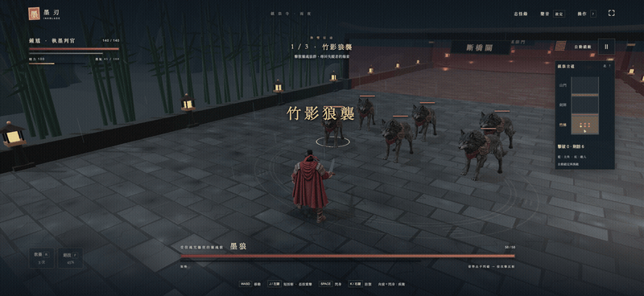
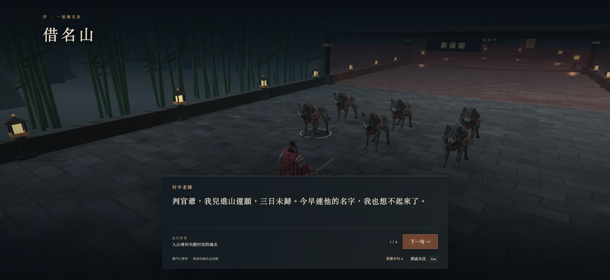
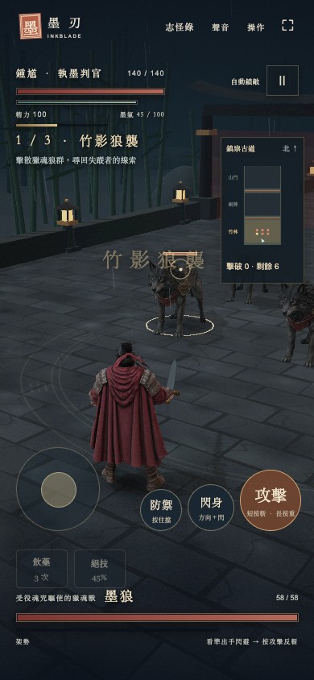

# 墨刃 · 3D 水墨格鬥遊戲

[English](README.en.md)

《墨刃》是一款以鍾馗與中國志怪故事為靈感的第三人稱 3D 動作遊戲原型。主角持劍走進雨夜古寺，追查村民姓名被奪走的原因。玩家在「無雙征途」中一路穿過狼群、劍陣，最後面對山魈。

**[立即在瀏覽器遊玩](https://inkblade-e2h.pages.dev/)**

## 遊戲畫面



| 劇情對話 | 手機操作 |
| --- | --- |
|  |  |

線上版使用 Cloudflare Pages，直接發布 `dist/` 中的遊戲檔案；GitHub `main` 更新後會自動重新部署。公開前將四個實戰角色的貼圖縮至 2048 像素，改用 WebP 並簡化網格，模型檔案合計由約 55 MB 降至 9.7 MB。後來加入的抄名鬼吏與鎮門石獸用 `scripts/compress-textures.mjs` 做同樣的貼圖處理，兩個模型由 31 MB 降至 7.4 MB；遊戲預設播放骨架動畫（`?rig=0` 可切回程序動作），用到的三個骨架模型也由 39 MB 降至 12.6 MB。

## 最近更新

**2026-11-14**

- **可以切換英文。** 右上角多了語言鍵（EN ／ 中文），介面、提示、招式名、全部對白與志怪錄都有英文版，隨時可切換，選擇會記在瀏覽器裡；第一次開啟時依瀏覽器語言決定，也可以用網址 `?lang=en` 或 `?lang=zh` 指定。場景裡的匾額、石碑與印章是畫面的一部分，維持中文。英文字句集中在 `dist/lang-en.js`，中文仍是唯一的原始文本。
- **修正：手機上連點攻擊會把畫面放大。** iPhone Safari 把快速連點當成「點兩下放大」，畫面被放大到只剩三顆按鈕、搖桿被擠出畫面，而且縮不回來。現在整個頁面不再接受點兩下與雙指縮放。
- **防禦時會走路。** 以前按住防禦移動，主角是舉著劍整個人平移、腳不動。現在往前與後退用動捕的備戰步伐，左右橫移用依骨架算出的步伐，上半身維持舉劍姿勢。做法記在 [`art/direction/rigged/README.md`](art/direction/rigged/README.md) 的「架勢步伐」。
- **首頁只留「開始征途」。** 拿掉「單挑迎戰」和對手選單：墨狼、沈寒舟、山魈三位對手都已經是征途中的頭目，新玩家不會再一開始就誤入最難的一場。
- **修正：** 從征途回到首頁後，主控台不再每一格報一次錯。
- **同一天稍早：** 征途擴成十章八境並加入新敵人（抄名鬼吏、鎮門石獸等）與新招式；台詞改成白話；主角、劍客、山魈預設播放骨架動畫；絕技「墨破山河」加上拉近特寫；首頁換上手繪主視覺。

## 故事與玩法

村民的名字被借走後，魂魄困在山中。鍾馗循著線索進入雨竹林，遇見受咒役使的墨狼；守路的劍客沈寒舟另有不得離開的理由。這場旅程的終點，是自稱能替村民消災的山魈。劇情透過對白、戰場喊話與志怪錄呈現。

- **無雙征途：** 一條約 350 公尺的上山路，十章八境：無名村、雨竹林、千名碑林、斷魂橋、燃名香道、山門前庭、借名殿，最後是鎮祟寺的兩階段決戰。敵人守在各自的位置，靠近才會驚動；途中有伏兵、十一種敵人、十二張可收集的「名拓」與三座補給的土地龕。戰鬥與故事接在同一條路線上，路線資料集中在 `dist/journey3d.js`。
- **動作戰鬥：** 輕重劍招、向前疾衝與疾衝攻擊、左右閃身、格擋彈反和破勢反擊。墨狼只使用近身攻擊，其他對手各有不同的進攻節奏。

## 本機遊玩

```bash
git clone git@github.com:ywchiu/inkblade.git
cd inkblade
npm ci
npm start
```

在支援 WebGL 2 的瀏覽器開啟 <http://127.0.0.1:4173/>。遊玩時不需要 AI 帳號或 API key。

## 基本操作

| 動作 | 操作 |
| --- | --- |
| 移動 | WASD 或方向鍵 |
| 攻擊 | 短按 J／滑鼠左鍵；長按可重擊 |
| 閃身與前衝 | 空白鍵；搭配移動方向 |
| 防禦與彈反 | 按住 K／滑鼠右鍵 |
| 回血／絕技 | R／F |

短按攻擊可以接五段連斬，長按同一鍵可出重擊；向前疾衝時按攻擊可接疾衝斬，奔跑中（Shift＋方向）按攻擊是躍淵斬。按住防禦時，短按攻擊擲出飛墨斬（墨氣 20），長按攻擊施放「敕令 · 鎮」（墨氣 40）。抓準時機閃過或彈開攻擊後，再按攻擊即可反擊。手機版以搖桿移動，把搖桿推出圈外就是奔跑；右側有攻擊、閃身、防禦三個主要按鈕。

## 用 AI 製作這款遊戲

1. **確定玩法和美術方向。** 先定主角、對手、雨夜古寺，以及單挑和連續闖關兩種玩法（單挑入口後來併入無雙征途，三位對手成為沿途的頭目）。美術以寫實東方神怪為主，讓水墨出現在氣氛與戰鬥效果中。
2. **產生角色參考圖。** 用 GPT Image 設計主角與場景，用 Nano Banana 2.1 設計其他角色。確認服裝、輪廓與配色一致後，再拿來製作模型。
3. **製作 3D 角色。** 用 Tripo H3.1 把參考圖轉成角色模型，放進遊戲檢查比例、材質和不同視角。
4. **完成可玩的系統。** 用 JavaScript 和 Three.js 製作 3D 場景、角色動作、戰鬥判定、敵人行為、關卡、介面和觸控操作。動作與戰鬥規則由遊戲程式驅動。
5. **加入故事和聲音。** 寫出《借名山》劇情與角色對白，用 ElevenLabs 語音模型配音（只錄了前幾章，目前遊戲內暫時關閉配音，開關是 `dist/story3d.js` 的 `VOICE_ON`）；配樂與音效使用 Higgsfield、Mirelo 和 Kenney 素材。
6. **實際試玩並調整。** 在瀏覽器檢查畫面、操作和戰鬥節奏，把不好讀、不順手的地方改到能完成整段征途。

AI 協助產生圖片、模型和聲音；Three.js 與遊戲程式把這些素材組成可以操作、對戰和推進故事的作品。README 上方的 GIF 與截圖來自實際遊戲畫面。

## 專案內容

`dist/` 是可執行的網頁遊戲與素材，`tests/` 放戰鬥和故事等自動測試。`art/direction/` 保留角色美術參考。想先看成果，執行 `npm start`；想檢查程式，執行：

```bash
npm run check
npm test
```
